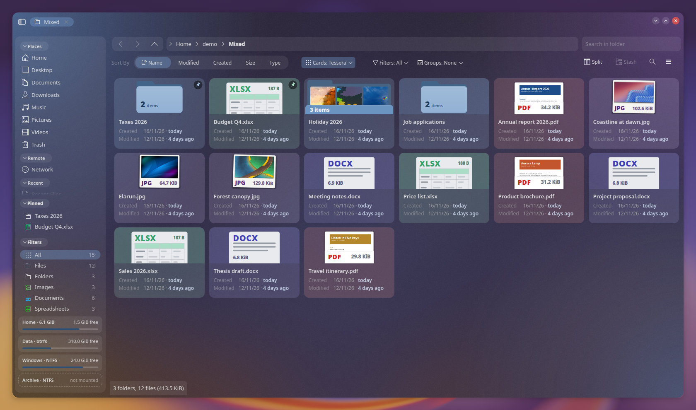

> **Fedora 44 and 45: there are ready-made packages on COPR**, no building needed:
> 
> ```
> sudo dnf copr enable morzilla/desktop-ng
> sudo dnf install dolphin-ng
> ```
> 
> It installs next to Fedora's Dolphin; open it with `dolphin-ng` or from the application menu. The same repository has the rest of the NG desktop: `breeze-ng`, `dolphin-ng`, `dialog-ng`, `neoline-icons` ([project page](https://copr.fedorainfracloud.org/coprs/morzilla/desktop-ng/)).
>
> **This is dolphin-ng**, a fork of KDE's Dolphin that rethinks how you work with your files. File operations are
> Dolphin's own; what changes is how files are shown and how quickly you get to what you need.
>
> 
>
> What it adds:
>
> - **Cards**, a fourth view mode in three looks: *Tessera* (the picture on top), *Scheda* (compact, three lines) and
>   *Dossier*, the file's identity card (pages and words, size in pixels, duration, where it was downloaded from).
>   A file without a preview gets a drawing of what it holds: a page, a sheet, lines of code, a waveform.
> - **Drawn rows**: the details view where every row carries that drawing, its type, size and how long ago it changed.
> - **One bar** for sorting, filtering by kind of file and grouping, one click each; it stays on one line in a narrow window.
> - **Groups that follow the sorting**: by date (today, yesterday, this week…), by size (folders, MB, KB), by name, by type.
> - **Pinned items**: files and folders that stay first whatever the sorting, with their own section in the sidebar.
> - **Quick actions** on each file: resize or convert an image, extract an archive, a PDF to images or text,
>   transcribe audio and video on your computer, convert media… plus your own commands.
> - **Work in progress on the file itself**: copies, conversions and transcriptions grow next to their source.
> - **A glass sidebar**: places, recent files, pinned items, filters with their counts, every disk with its usage.
> - **Selections that read as one**: neighbouring selected items share one outline.
> - **The same look in every app's Open/Save window** with [Dialog NG](https://github.com/Morzilla/dialog-ng), and
>   in the whole desktop with [Breeze NG](https://github.com/Morzilla/breeze-ng) (Soft, Glass, Aurora Glass, dark and light).
>
> Every setting has a page of its own (Configure › NG): nothing is imposed.
>
> **Every feature in detail, with pictures: [NG.md](NG.md)** and the longer tour in [FEATURES.md](FEATURES.md).
>
> **Try it:** on Fedora with the COPR packages above; anywhere else with the graphical installer:
> [how it works and how to run it](https://github.com/Morzilla/breeze-ng/blob/ng/NG.md#everything-at-once) (it sets up
> Dolphin NG and, if you want, the rest of the NG desktop, all in your home folder, next to the stock Dolphin).
>
> Like Dolphin, dolphin-ng is free software under the GNU General Public License, version 2 or (at your option) any
> later version (GPL-2.0-or-later): see [LICENSE](LICENSE), [COPYING](COPYING) and [LICENSES/](LICENSES/). The rest of
> this file is Dolphin's own README.

# Dolphin

Dolphin is KDE's file manager that lets you navigate and browse the contents of your hard drives, USB sticks, SD cards, and more. Creating, moving, or deleting files and folders is simple and fast. See more information [on Dolphin's homepage](https://apps.kde.org/dolphin/).


## User Documentation

See https://userbase.kde.org/Special:myLanguage/Dolphin.

## Contributing

Like other projects in the KDE ecosystem, contributions are welcome from all. This repository is managed in [KDE Invent](https://invent.kde.org/system/dolphin), our GitLab instance.

* Want to contribute code? See the [GitLab wiki page](https://community.kde.org/Infrastructure/GitLab) for a tutorial on how to send a merge request.
* Reporting a bug? Please submit it on the [KDE Bugtracking System](https://bugs.kde.org/enter_bug.cgi?format=guided&product=dolphin). Please do not use the Issues
tab to report bugs.
* Is there a part of Dolphin that's not translated? See the [Getting Involved in Translation wiki page](https://community.kde.org/Get_Involved/translation) to see how
you can help translate!

If you get stuck or need help with anything at all, head over to the [KDE New Contributors room](https://go.kde.org/matrix/#/#kde-welcome:kde.org) on Matrix. For questions about Dolphin, please ask in the [KDE File Management room](https://go.kde.org/matrix/#/#kde-fm:kde.org). See [Matrix](https://community.kde.org/Matrix) for more details.

## Development Philosophy

Dolphin is a file manager focusing on usability. When reading the term Usability people often assume that the focus is on newbies and only basic features are offered. This is not the case; Dolphin is quite full-featured, but the features are carefully chosen so as to not impede any of the users in the target user groups.

### Target User Groups

Focusing on usability means that features are discoverable and efficient to use. The feature set is defined indirectly by the target user group of Dolphin:

- **Lisa**: Lisa has been familiar with computers for 10 years. From her job, she has experience with Word, Excel and Outlook. At home she mainly uses the computer for browsing the web and writing e-mails. She requires a file manager for managing photos from the camera, documents she gets via e-mail, or PDFs she downloads with a browser. Lisa knows concepts like folders and a file hierarchy, but she is not familiar with the file hierarchy of Linux.

- **Simon**: Simon has been a developer at a software company for 8 years. At home he uses a file manager to maintain his large collection of photos and music. Additionally he owns a small homepage and needs to transfer updated files on the FTP server. Moving and copying files are regular tasks in Simon's workflow.

Not part of the target user group of Dolphin are Fred and Jeff:

- **Fred**: Fred is 75 years old and is able to write e-mails and browsing the web. He is not familiar with file hierarchies and stores all his documents on the desktop.

- **Jeff**: Jeff is Linux-freak since the age of 16 a few years ago. He is a developer and in his spare time he acts as administrator for a small company. Jeff has two monitors to keep the overview about his huge number of opened applications.

This does not mean that Fred or Jeff cannot work with Dolphin. But there might be features and concepts of Dolphin that overburden Fred. Also Jeff might miss some features which are a must-have for his daily work. This is acceptable; there are other tools that cater specifically to their needs.

### Non-Intrusive Features

Before a feature is added in Dolphin, check whether the feature is mandatory for the target user group. If this is not the case, then this does not mean that the feature cannot be added; first it must be clarified whether the feature might be non-intrusive, so that it adds value for users outside the primary target user group of Dolphin. The term "non-intrusive" is mainly related to the user interface. A feature that adds a lot of clutter to the main menu, context menus or toolbar might harm the target user group. In this case the feature should not be added.

A good example of a feature that is non-intrusive is the embedded terminal in Dolphin. It only requires one entry inside a sub-menu, but adds great value for Jeff, who is not part of the target user group.

### Options

Options are mandatory as the "average Joe" user does not exist. Still it is not the goal of Dolphin to offer options for all kind of things. Again the focus is on the possible needs of the target user group. Each additional option makes it harder finding other options, so the same rules for features are applied to options too.
